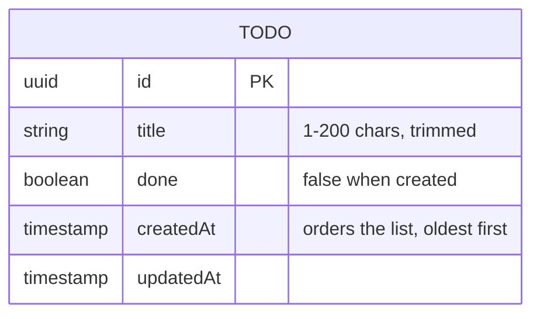

# Domain model

The app holds one kind of record: a todo in a single shared list. There are no users, so nothing is owned by anyone.

The list is ordered by `createdAt` ascending, with `id` as the tiebreaker.